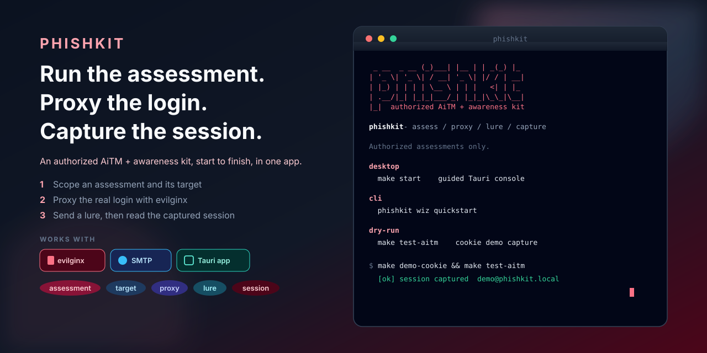

<h1 align="center">phishkit</h1>

<p align="center">
  
</p>

<p align="center">
  <b>An authorized adversary-in-the-middle (AiTM) and awareness kit, start to finish, in one desktop app.</b>
</p>

<p align="center">
  Website: <b><a href="https://phishkit.openhat.dev">phishkit.openhat.dev</a></b> · Org: <a href="https://github.com/openhat-security">openhat-security</a>
</p>

<p align="center">
  <a href="https://github.com/openhat-security/phishkit/blob/main/LICENSE"></a>
  <a href="https://phishkit.openhat.dev"></a>
  <a href="https://openhat-security.github.io/phishkit/"></a>
  <a href="https://github.com/openhat-security/phishkit/releases"></a>
</p>

phishkit wraps [evilginx2](https://github.com/kgretzky/evilginx2) (an AiTM proxy) and a
native email engine into one workflow: **assessment → target → proxy → lure → campaign →
session**. An expert operator keeps full control; a non-technical user can run a safe
click-through campaign from the guided wizard. The supported product is the Tauri desktop app,
with a headless CLI for scripting.

> **Alpha, `v0.1.1-alpha.1`.** This is an early, in-progress release. Expect breaking changes.
> The CLI installs from Homebrew today. The desktop app builds from source for now, while the
> signed `.dmg` and AppImage installers are still being set up.

> **Authorized assessments only.** phishkit drives an AiTM proxy, sends email, and handles
> captured credentials and live session tokens. Run it only with explicit written authorization
> from the owner of the targeted systems and people. Read [authorized use](docs/guide/authorized-use.md)
> and the [threat model](docs/reference/threat-model.md) first. The bundled demos use local mock
> apps only; never point automation at systems you are not authorized to test.

## Quick start

Install, then try the whole AiTM flow against a local mock app that ships with the repo. No real
target, no email, no privileges beyond a loopback host entry.

```bash
# 1) Install. Two packages: the desktop app (cask) and the headless CLI (formula).
brew install --cask openhat-security/tap/phishkit   # desktop UI (see note below)
brew install openhat-security/tap/phishkit-cli      # CLI: installs `phishkit` and `phishkit_ctl`

# 2) Launch the desktop console, or run the CLI
open -a phishkit            # desktop app
phishkit --help            # CLI (or: make start, from a source checkout)
```

The CLI formula works today. The desktop cask points at the signed `.dmg` and AppImage, which
are still being built, so for now install the desktop app from source (see [Install](#install)).

Dry-run the capture surface from a source checkout, which stands up an HTTPS upstream and drives
the cookie demo login through evilginx:

```bash
git clone --recurse-submodules https://github.com/openhat-security/phishkit.git
cd phishkit
make build          # build the evilginx binary from the vendored source
make demo-cookie    # cookie-session mock app on :9080
make test-aitm      # proxy the login and capture the session (unprivileged)
```

The demo login is `demo@phishkit.local` / `demo-password`. A captured `session` cookie means the
AiTM path works on your machine. The full split-host dry-run, with a real lure URL you open in a
browser, is in [AiTM demo end to end](docs/guide/walkthrough.md#aitm-demo-end-to-end).

From there, point phishkit at a system you are authorized to assess: add the target, author or
pick a phishlet, configure your own SMTP or ESP sender, and run a campaign from
**Review → Test → Launch**. See the [quick start guide](docs/guide/quick-start.md) and the
[walkthrough](docs/guide/walkthrough.md).

## What it does

- **Run one assessment end to end.** Take an engagement from target and proxy setup through to a
  captured session in the desktop app, without stitching separate tools together.
- **Send with a native mail engine.** A draft → review → test → launch composer bound to a target,
  lure, sender, template, and recipient list, with send windows and delivered/opened/clicked/bounced
  tracking through your own SMTP or ESP. Sender and content are snapshotted at creation for audit.
- **Capture and attribute sessions.** evilginx captures what an attacker would actually get,
  attributed back to the campaign attempt, with a Sessions view for timeline, masked credentials,
  token summary, export, and gated replay.
- **Serve two audiences.** A guided wizard and a preset scenario library with safe defaults for
  business users, over full Advanced controls for operators.
- **Run awareness-only campaigns.** A click-only training mode that never captures credentials.

## Install

```bash
# Desktop app (macOS / Linux) via Homebrew cask
brew install --cask openhat-security/tap/phishkit

# Headless CLI only (macOS / Linux) via Homebrew formula
brew install openhat-security/tap/phishkit-cli

# from source (recommended for alpha)
git clone --recurse-submodules https://github.com/openhat-security/phishkit.git
cd phishkit
make build          # vendor sources + build the evilginx binary
make setup          # rust check + desktop deps + docs deps
make start          # run the desktop app (tauri dev)

# headless CLI
make cli
./target/release/phishkit --help
./target/release/phishkit wiz quickstart      # guided new assessment (TTY)
```

Building from source needs git, Rust stable (`~/.cargo/bin` on `PATH`), Node (see `.nvmrc`), the
Go toolchain (to build evilginx once), and the Tauri prerequisites for your OS. The AiTM lure also
needs `screen` and Python `pexpect`, which `make setup` installs into a managed `venv/`. Full
platform notes are in the [install guide](docs/guide/install.md) and
[platform support](docs/reference/platform-support.md).

Packaging stubs: [packaging/README.md](packaging/README.md) · Releases:
[github.com/openhat-security/phishkit/releases](https://github.com/openhat-security/phishkit/releases)

## Documentation

The full site is **[phishkit.openhat.dev](https://phishkit.openhat.dev)**
(mirror: [openhat-security.github.io/phishkit](https://openhat-security.github.io/phishkit/)).

- [What phishkit is](docs/guide/index.md)
- [Authorized use](docs/guide/authorized-use.md)
- [Install](docs/guide/install.md)
- [Quick start](docs/guide/quick-start.md)
- [Walkthrough](docs/guide/walkthrough.md)
- [Campaign guide](docs/guide/campaigns.md)
- [Phishlet authoring](docs/guide/phishlets.md)
- [Command line](docs/guide/cli.md)
- [Testing](docs/guide/testing.md)
- [Architecture](docs/reference/architecture.md)
- [Threat model](docs/reference/threat-model.md)
- [Privacy](docs/reference/privacy.md)
- [Changelog](CHANGELOG.md) · [Security policy](SECURITY.md)

## Repository map

| Path | Role |
|------|------|
| `apps/desktop/` | Tauri desktop app (React + Rust), the supported product |
| `apps/cli/` | Headless `phishkit` / `phishkit_ctl` |
| `crates/phishkit-core/` | Shared Rust engine |
| `kit/evilginx/` | Kit-owned phishlets, scripts, inject helpers |
| `demos/` | Localhost practice apps (`cookie`, `firebase`) |
| `docs/` | VitePress docs; generated videos stay local (gitignored) |
| `tests/` | `unit/` (Rust) and `integration/` (desktop UI + Docker) |
| `vendor/` | `evilginx2` submodule + community phishlet packs |
| `packaging/` | Homebrew / AUR / Debian stubs |

## Develop

`make help` lists every target. The checks that mirror CI:

```bash
make test                      # cargo fmt --check + cargo test (core + cli)
make lint                      # cargo clippy --all-targets
make test-integration-docker   # desktop UI suite in Linux + Xvfb (optional)
```

Do not run the desktop UI suite against your live Application Support database. Work on the docs
site with `make docs` (preview) and `make docs-build` (fails on broken internal links). See
[Testing](docs/guide/testing.md).

## Contributing

Contributions are welcome under GPL-3.0. Read [CONTRIBUTING.md](CONTRIBUTING.md) and the
[Code of Conduct](CODE_OF_CONDUCT.md) first. Report security issues privately per
[SECURITY.md](SECURITY.md), never in a public issue. Requests to enable unauthorized use are out
of scope.

## License

phishkit is licensed under [GPL-3.0](LICENSE). It orchestrates and templates around upstream
open-source projects, notably [evilginx2](https://github.com/kgretzky/evilginx2); you are
responsible for understanding and complying with their licenses. phishkit is an independent
project. Use it lawfully and only with written authorization.
